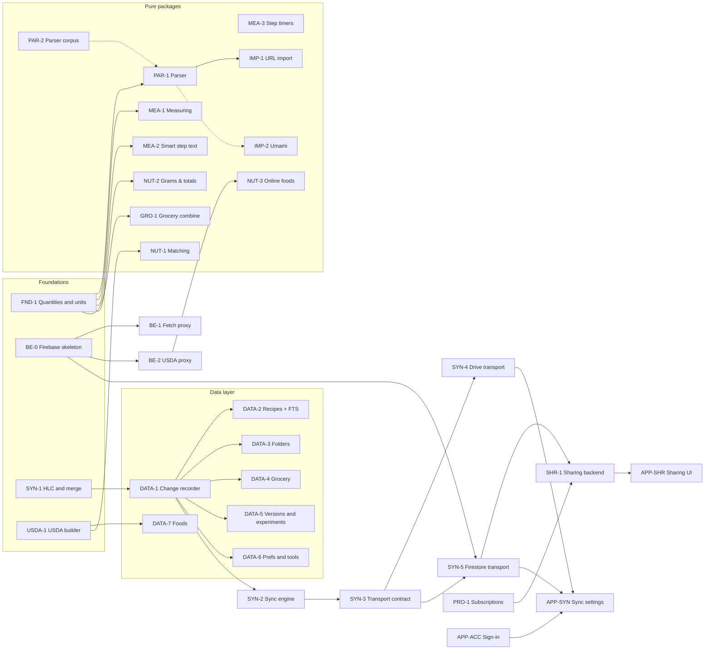

# Sousvite: Build Plan

| | |
|---|---|
| **Status** | Draft |
| **Owner** | Tyler |
| **Last updated** | 2026-11-13 |
| **Companion docs** | [PRD](PRD.md), [Engineering design](ENGINEERING.md), [Design system](DESIGN_SYSTEM.md) |

---

## 1. Purpose

This plan splits the whole launch (PRD §7, everything ships in one release) into tasks that many agents can build **at the same time without editing the same files**. Each task says which paths it owns, what it depends on, and when it is done.

It does not repeat technical decisions. [ENGINEERING.md](ENGINEERING.md) and [DESIGN_SYSTEM.md](DESIGN_SYSTEM.md) remain the source of truth. If a task needs to change a decision, it updates that doc in the same PR (ENGINEERING §1).

The last section (§8) is the checklist of accounts and keys only Tyler can create.

## 2. Starting point: the scaffold

Every task starts after the **scaffold** (task `S0`, a short series of PRs built in its own thread) has fully merged. Tasks below rely on the scaffold providing:

| Area | What the scaffold provides |
|---|---|
| Workspace | Pub workspace with `apps/sousvite` and every package in ENGINEERING §4.2 (plus `tools/usda_builder`) as an empty shell. A shell joins the CI matrix in `.github/workflows/ci.yml` in the PR that adds its first tests; a CI check fails if a member has tests but no CI job |
| CI | `very_good_workflows` jobs per package, format, analyze, tests, coverage gate, web build; required checks on `main` |
| `packages/domain` | `freezed` entities for every ENGINEERING §7.1 entity (one file each under `lib/src/entities/`; steps are `RecipeStep` to avoid clashing with Flutter's `Step`, and ingredient groups are `IngredientSection`), value objects `Quantity` (exact rational), `Unit`, `SortKey` (fractional index), typed ids, and one minimal repository interface per aggregate (watch, get, save, delete) |
| `packages/data` | Full Drift schema for all §7.1 tables including `change_log` and `sync_state`, one table file per aggregate under `lib/src/tables/`, and one empty DAO per aggregate already registered in `@DriftDatabase`. **No** repository implementations and **no** FTS5 yet |
| `packages/design_system` | Tokens and theme (DESIGN_SYSTEM §13.1 `tokens/` and `theme/`). **No** §9.2 components yet |
| App shell | `lib/app/router.dart` composes `lib/features/<name>/<name>_routes.dart` with a placeholder screen per feature; shell with Library, Grocery list, and Settings tabs |
| Shared app code | `AsyncValueView` in `lib/shared/widgets/`, `BuildCounter` and `pumpApp` in `test/helpers/`, one `lib/l10n/arb/app_en.arb` read through `context.l10n` |
| Bootstrap | `bootstrap.dart` wiring `ErrorReporter` into Flutter's error hooks. Stub interfaces and providers for `ErrorReporter`, `AuthService`, `Entitlements`, and `NutritionApi` in `lib/app/services/`; one throwing provider per repository interface in `lib/app/providers/repositories.dart`; the database provider in `lib/app/providers/database.dart` |
| Conventions | `CLAUDE.md` with coding rules (small widgets, Riverpod patterns, tests) |
| App id | `com.tytaniumdev.sousvite` (Android application id and iOS bundle id, registered in Firebase; permanent once the store records exist, see §8) |

If any of this turns out to be missing when the scaffold merges, add a task for it to wave 1 before anything that depends on it.

## 3. Rules for parallel work

These rules are what keep agents from colliding. They apply to every task.

### 3.1 Ownership

1. **One task, one PR, one branch.** Branch name `task/<id>-<short-slug>`, for example `task/par-1-ingredient-parser`.
2. **Edit only the paths your task owns** (listed in §6), plus the shared files in §3.2. Tests live next to the code they test and are owned by the same task.
3. **Ownership is by folder.** Where two tasks share a package, each owns a different `lib/src/<module>/` folder and the matching `test/<module>/` folder.
4. **Depend on interfaces, not implementations.** UI and application tasks code against the repository interfaces in `packages/domain` and test with hand-written fakes. They do **not** wait for the data task that implements the interface. The two meet when the data task replaces the throwing body of its provider in `app/lib/app/providers/repositories.dart` with the real repository. Feature tests keep overriding that provider with fakes.
5. **A feature's public surface is one file.** Another feature may import only `lib/features/<name>/<name>.dart` (for example, the recipe page imports `NutritionSummary` from `features/nutrition/nutrition.dart`). Everything else in a feature folder is private to it.

### 3.2 Shared files

Some files are touched by many tasks. Keep each change to them small, so conflicts are trivial to resolve on rebase.

| File | Rule |
|---|---|
| `packages/*/pubspec.yaml` | Add only the dependencies your task needs, in alphabetical order. Versions come from the root constraints if the scaffold set them |
| `.github/workflows/ci.yml` | Add one matrix entry (`package:` and `min_coverage:`) when your package gets its first tests |
| `pubspec.lock` | Never hand-merge. After a rebase, run `flutter pub get` and commit the result |
| Generated code (`*.g.dart`, `*.freezed.dart`, Drift schema snapshots) | Never hand-merge. After a rebase, rerun `build_runner` and commit the result |
| `packages/design_system/lib/design_system.dart` | Append one `export` line per new widget |
| `apps/sousvite/lib/app/providers/repositories.dart` | A data task replaces only the body of its own repository's provider |
| `apps/sousvite/lib/l10n/arb/app_en.arb` | Add keys in your feature's block, prefixed with the feature name (`cooking_nextStep`). Never rename or remove another feature's keys |
| `functions/src/index.ts` | Add one `export` line per new function, in alphabetical order |
| `functions/package.json` | Add only the dependencies your task needs. Never hand-merge `functions/package-lock.json`; after a rebase, run `npm install` in `functions/` and commit the result |
| `packages/domain` entities and interfaces | Additive changes only (new fields with defaults, new methods). Anything else is a separate small PR merged first, see §3.3 |

### 3.3 Changes to shared foundations

- **Drift schema changes** (new column, new table, new index) go in their own small PR that bumps `schemaVersion`, adds the migration, and adds the schema snapshot (ENGINEERING §7). Only **one** schema PR may be open at a time: open a GitHub issue labelled `schema` before starting and close it on merge. Other tasks rebase after it lands.
- **Domain changes** that are not purely additive follow the same pattern with the `domain` label.
- **Decisions.** If a task finds that ENGINEERING or DESIGN_SYSTEM is wrong or silent, it picks the documented default if there is one, notes it in the PR description, and updates the doc in the same PR. Choices that change what the user sees or would be hard to undo are raised with Tyler first.

### 3.4 Definition of done (every task)

- Code follows `CLAUDE.md`, ENGINEERING §5 (rebuild discipline) and §6 (Riverpod), and DESIGN_SYSTEM §13.3 (no raw colors, font sizes, or spacing outside `design_system`).
- Tests at the level ENGINEERING §15 asks for: unit tests for pure code, widget tests **with rebuild counts** for UI, goldens for design-system widgets (light, dark, cooking light, cooking dark, 200% text).
- CI is green, including the coverage gate. The PR merges automatically once it is.
- Any new user-facing string is in `app_en.arb`.
- A package's first tests come with its matrix entry in `.github/workflows/ci.yml` (§3.2); CI fails otherwise.

### 3.5 Tracking

Each task in §6 becomes a GitHub issue titled `<ID>: <name>`, with labels for its wave and area. An agent claims a task by assigning the issue and opening a draft PR that links it (`Closes #n`). A task is ready to start when every task in its **Depends on** column is merged.

## 4. Dependency overview

Arrows point from a task to the tasks that need it. `S0` (the scaffold) comes before everything and is left out to keep the graph readable. Dotted arrows are soft dependencies: the task can start against an interface or fake, and finishes wiring once the other task merges.

The app feature tasks (`APP-*`) are left out of the graph above except where they block other work. Their dependencies are listed in §6.5, and almost all of them are soft, so UI work starts in wave 1 against fakes.

**Critical path:** `S0 → SYN-1 → DATA-1 → SYN-2 → SYN-3 → SYN-5 → SHR-1 → APP-SHR → E2E-1`. Sync and sharing are the longest chain, so they should be staffed first.

## 5. Waves

Waves are a guide to ordering, not phases of the product (the PRD ships everything at once). A task can start as soon as its dependencies merge, whatever its wave.

| Wave | Starts when | Tasks |
|---|---|---|
| 1 | `S0` merges | `FND-1`, `BE-0`, `SYN-1`, `USDA-1`, `PAR-2`, `MEA-3`, `DS-1`, `DS-2`, `DS-3`, `OBS-1`, and the feature tasks `APP-LIB`, `APP-REC`, `APP-EDIT`, `APP-IMP`, `APP-NUT`, `APP-COOK`, `APP-GRO`, `APP-EXP`, `APP-SET`, `APP-ACC` against fakes |
| 2 | Its wave-1 dependencies merge | `PAR-1`, `MEA-1`, `MEA-2`, `GRO-1`, `NUT-1`, `NUT-2`, `BE-1`, `BE-2`, `DATA-1`, `PRO-1`, `IMP-2` (needs Tyler's Umami export) |
| 3 | | `IMP-1`, `NUT-3`, `DATA-2` to `DATA-7`, `SYN-2`, `MEDIA-1` |
| 4 | | `SYN-3`, `SYN-4`, `SYN-5` |
| 5 | | `SHR-1`, `APP-SYN`, `MEDIA-2`, `REL-1` |
| 6 | | `APP-SHR` |
| 7 | Everything else merged | `E2E-1`, beta readiness (§7) |

## 6. Tasks

Paths are relative to the repo root. `app/` means `apps/sousvite/`. Every task also owns the tests for its paths.

### 6.1 Foundations

| ID | Task | Owns | Depends on | Done when |
|---|---|---|---|---|
| FND-1 | **Quantities and units.** Rational arithmetic on `Quantity`, unit aliases and families (US volume, metric volume, weight, count), conversion between US customary and metric, scaling by servings or multiplier, rounding to amounts people can measure (PRD 7.6) | `packages/domain/lib/src/value_objects/quantity.dart` and `unit.dart`, and a new `packages/domain/lib/src/units/` | S0 | ⅓ cup × 3 equals 1 cup exactly; conversion and rounding tables are unit-tested; 90% coverage |
| BE-0 | **Firebase skeleton.** `functions/` TypeScript project, `firebase.json`, `firestore.rules` (deny all), `storage.rules` (deny all), emulator config using a `demo-sousvite` project id (works with no real project), rules test harness, CI job that lints, builds, and runs function and rules tests against the emulators | `functions/**`, `firebase.json`, `.firebaserc`, `firestore.rules`, `firestore.indexes.json`, `storage.rules`, `.github/workflows/functions.yaml` | S0 | CI runs the emulators and a sample rules test passes; no real Firebase project needed |
| SYN-1 | **Clock and merge core.** Hybrid logical clock, `Change` model (ENGINEERING §8.1), per-field last-writer-wins merge, tombstones, idempotent apply, and the "losing long text goes to history" rule as a pure function | `packages/sync/lib/src/core/` | S0 | Randomized multi-device tests show every replica converges; 90% coverage |
| USDA-1 | **USDA builder.** CLI that turns the FoodData Central Foundation and SR Legacy CSV releases into the compact read-only SQLite file (foods, nutrients, portions), with a fixed schema version. The generated file is committed to the repo as a normal file, no Git LFS (§9.1) | `tools/usda_builder/**`, `apps/sousvite/assets/nutrition/usda_foods.sqlite` | S0 | Running the CLI on the official release produces the file and it is committed; the file is only ever regenerated with the CLI, never edited by hand; schema documented in the tool's README; tests run on a small CSV fixture |
| OBS-1 | **Crash reporting.** Sentry implementation of the scaffold's `ErrorReporter`, reading the DSN from a `--dart-define`, off when no DSN is set. Debug-symbol and source-map upload left to `REL-1` | `app/lib/app/services/error_reporter.dart` (replaces the stub), `app/lib/bootstrap.dart` (Sentry init only) | S0 | Errors reach Sentry when a DSN is given; the app runs with none; tests use a fake reporter |

### 6.2 Design system components

The components in DESIGN_SYSTEM §9.2, split by the feature that needs them first. Each widget is its own file under `packages/design_system/lib/src/widgets/` with golden tests in all five variants (§13.1). The three tasks touch different files and only append to `design_system.dart`.

| ID | Task | Widgets | Depends on |
|---|---|---|---|
| DS-1 | Amounts and cooking | `AmountText`, `StepText`, `MeasuringGuide`, `IngredientRow`, `IngredientSplitPreview`, `TimerChip`, `SectionHeader` | S0 |
| DS-2 | Nutrition | `MacroBar`, `MacroSummary`, `NutrientRow`, `MatchStatusChip`, `BasisToggle`, `ServingStepper`, `CompactDensity` | S0 |
| DS-3 | Library, status, and states | `RecipeCard`, `GroceryItemRow`, `ShareBadge`, `ExperimentBadge`, `ProBadge`, `SyncStatusIcon`, `EmptyState`, `ErrorState` | S0 |

`DS-1` should also add the contrast checks from DESIGN_SYSTEM §12 for the colors it uses, if the scaffold did not already add `contrast_test.dart`.

### 6.3 Pure Dart packages

| ID | Task | Owns | Depends on | Done when |
|---|---|---|---|---|
| PAR-2 | **Parser corpus.** Fixture file of several thousand real ingredient lines with expected results (ENGINEERING §12), covering every case in that section. Can start right away, since it is data | `packages/ingredient_parser/test/fixtures/` | S0 | Fixture format documented; corpus checked in |
| PAR-1 | **Ingredient parser.** The rule-based parser and its public API (`parse(String) → ParsedLine`), run against the corpus in CI | `packages/ingredient_parser/lib/**`, other `test/` files | FND-1; PAR-2 (soft) | Corpus pass rate reported in CI and at least 95% (raise as it improves); every failure found later becomes a fixture |
| MEA-1 | **Measuring decomposition.** Fewest owned tools for an amount, within a rounding tolerance (ENGINEERING §13); standard tool set as the default | `packages/measuring/lib/src/decompose/` | FND-1 | ¾ cup → ½ + ¼ cup; 5 tsp → 1 Tbsp + 2 tsp; custom tool sets tested |
| MEA-2 | **Smart step text.** Find ingredient mentions in step text and produce segments with scaled amounts (the `segments` input of `StepText`) | `packages/measuring/lib/src/step_text/` | FND-1 | Tested on a fixture set of real recipes; replacements are marked so the editor can show and undo them |
| MEA-3 | **Step timers.** Find times in step text ("bake 20 to 25 minutes") and return durations and labels for `TimerChip` | `packages/measuring/lib/src/timers/` | S0 | Ranges, hours and minutes, and "overnight" style phrases tested |
| GRO-1 | **Grocery logic.** Combine items across recipes ("2 onions + 1 onion"), with unit conversion where safe, and assign store sections with a deterministic keyword table | `packages/domain/lib/src/grocery/` | FND-1 | Combining and section tables unit-tested |
| IMP-1 | **URL import.** schema.org JSON-LD, then microdata, then heuristics; ingredient lines through the parser; result is an unsaved recipe draft. Fixtures are saved HTML pages from popular recipe sites | `packages/recipe_import/lib/src/url/` | PAR-1 | Fixture pass rate reported; failure reasons are typed so the app can report them by site (PRD §10) |
| IMP-2 | **Umami import and export.** Read and write Umami's export format, including folders and photos where possible, and document what transfers | `packages/recipe_import/lib/src/umami/` | S0; PAR-1 (soft); **Tyler's sample Umami export (§8.10)** | Round trip of Tyler's export loses nothing the doc says is kept |
| NUT-1 | **Food matching.** Normalize, synonym table, rank candidates by token overlap, prefer generic USDA; unmatched is explicit (ENGINEERING §11.2) | `packages/nutrition/lib/src/matching/` | USDA-1 (food schema) | Match accuracy measured on a fixture of common ingredients; target 90% (PRD §8) |
| NUT-2 | **Grams and totals.** Unit → grams via USDA portions, then a curated density table; batch totals and per serving for a given serving size | `packages/nutrition/lib/src/convert/`, `packages/nutrition/lib/src/totals/` | FND-1 | Pure functions with worked-example tests |
| NUT-3 | **Online foods.** Clients for USDA Branded Foods (through `BE-2`) and Open Food Facts, with our `User-Agent` (§8.6); results returned as domain `Food` values for caching by `DATA-7` | `packages/nutrition/lib/src/online/`, `app/lib/app/services/nutrition_api.dart` (replaces the `OfflineNutritionApi` stub) | BE-2 | Clients tested against recorded responses; OFF attribution kept on each food |

### 6.4 Data layer and backend

Each `DATA-*` task implements one aggregate's repository interface, fills in its DAO, and replaces the body of its provider in `app/lib/app/providers/repositories.dart` (§3.2). DAOs live in `packages/data/lib/src/daos/`.

| ID | Task | Owns | Depends on | Done when |
|---|---|---|---|---|
| DATA-1 | **Change recorder.** Writes `change_log` rows with HLC timestamps in the same transaction as each write; a small API every repository uses | `packages/data/lib/src/change_log/`, `sync_dao.dart` | SYN-1 | Every write path in a test DB produces the right change rows |
| DATA-2 | **Recipes.** Recipe, ingredient lines, sections, and steps; fractional sort keys; FTS5 over titles, ingredient names, and folder names (a schema PR, §3.3) | `packages/data/lib/src/recipes/`, the recipe DAO | DATA-1 | Watch queries are `distinct()`; search tested; migration snapshot added |
| DATA-3 | **Folders.** Folders and many-to-many entries | `packages/data/lib/src/folders/`, the folder DAO | DATA-1 | |
| DATA-4 | **Grocery lists.** Lists and items linked to source lines | `packages/data/lib/src/grocery/`, the grocery DAO | DATA-1 | |
| DATA-5 | **Versions and experiments.** Snapshots, experiments, promote, restore, and the losing-edit history entries from `SYN-1` | `packages/data/lib/src/history/`, the history DAO | DATA-1 | Promote and restore are single transactions |
| DATA-6 | **Preferences and tools.** `UserRecipePrefs`, `MeasuringTool`, and app settings (theme mode, units, sync choice). The scaffold has no settings table, so adding one is a schema PR (§3.3); say in the PR which settings sync and which stay on the device | `packages/data/lib/src/prefs/`, `user_recipe_prefs_dao.dart`, `measuring_tool_dao.dart` | DATA-1 | |
| DATA-7 | **Foods.** Attach the bundled USDA file read-only, cache branded and OFF foods, store `NutritionMatch` rows; web download-once of the bundled file | `packages/data/lib/src/foods/`, the food DAO | USDA-1 | Works on all three platforms; replacing the bundled file needs no migration |
| BE-1 | **Fetch proxy** for web URL import, App Check enforced, with an allow-list of content types and a size limit | `functions/src/fetch_proxy/` | BE-0 | Emulator tests; rejects requests without App Check |
| BE-2 | **USDA proxy.** Forwards search and food requests, adds the API key from a function secret, caches responses | `functions/src/usda_proxy/` | BE-0 | Emulator tests with a fake upstream; key never reaches the client |

### 6.5 App features

Each feature task owns `app/lib/features/<name>/**` and `app/test/features/<name>/**`, including the `<name>_routes.dart` that replaces the scaffold's placeholder. Everything starts against fakes (§3.1 rule 4), so the **Needs** column lists what must merge before the feature is finished, not before it starts.

| ID | Feature | Scope (PRD) | Needs before done |
|---|---|---|---|
| APP-LIB | `library` | Recipe list, folders, a recipe in several folders, search (7.1) | DS-3, DATA-2, DATA-3 |
| APP-REC | `recipe` | Recipe page: header, photo, servings stepper and scaling, unit toggle, ingredients, sections and steps, nutrition summary from `features/nutrition/nutrition.dart`, entry points to cook, grocery, experiment, share (7.1, 7.6) | DS-1, DS-2, FND-1, DATA-2 |
| APP-EDIT | `editor` | Create and edit; typed or pasted ingredient lines with `IngredientSplitPreview` and fixes; named, reorderable sections; duplicate and delete (7.1, 7.3). The review screen used by import lives here | DS-1, PAR-1, DATA-2 |
| APP-IMP | `import` | Paste a URL, share sheet on iOS and Android (share extension and intent filter are native files this task owns), import review via the editor, Umami import and export, failure reporting (7.2) | IMP-1, IMP-2, APP-EDIT, BE-1 (web) |
| APP-NUT | `nutrition` | Summary widget, per serving or per batch, detailed nutrients, match list with source, change a match, branded product search, unmatched flags (7.4) | DS-2, NUT-1, NUT-2, NUT-3, DATA-7 |
| APP-COOK | `cooking` | One step at a time, swipe or tap, screen awake, sections in order, smart step text, measuring guide, ingredients for this step with check-off, timers, high-contrast theme (7.5) | DS-1, MEA-1, MEA-2, MEA-3, DATA-2, DATA-6 |
| APP-GRO | `grocery` | Add to grocery list sheet with line-by-line include, several recipes per list, combined items by store section, check-off, manual items (7.7) | DS-3, GRO-1, DATA-4 |
| APP-EXP | `experiments` | Start, edit, record what changed and how it went, promote or keep, history timeline, view and restore past versions (7.11) | DATA-5 |
| APP-SET | `settings` | Theme mode, units, my measuring tools, about and licenses including Open Food Facts attribution (7.5, 7.6) | DATA-6 |
| APP-ACC | `account`, plus `app/lib/app/services/auth_service.dart` | Optional sign-in with Google or Apple replacing the `AuthService` stub, attaching existing local data on first sign-in, sign-out (7.9), and **delete account**, which both stores require: a `delete_account` function (`functions/src/delete_account/`) deletes the Firebase user and their server data, and the device keeps a local copy | BE-0; Auth emulator for tests; §8.1 to §8.4 for real devices |
| APP-SYN | `account/sync/` (subfolder) | Choose Drive or Sousvite cloud, switch between them, sync status in the shell via `SyncStatusIcon` (7.8) | APP-ACC, SYN-4, SYN-5 |
| APP-SHR | `sharing` | Share jointly or send a copy, recipient sees which, leave a joint share, view-only links, experiment "Share with others" toggle (7.10, 7.11) | SHR-1 |
| PRO-1 | `account/pro/` (subfolder), `app/lib/app/services/entitlements.dart`, `functions/src/revenuecat_webhook/` | Paywall, RevenueCat SDK, `Entitlements` implementation replacing the scaffold stub, webhook that writes the entitlement to Firestore (7.12) | BE-0; §8.7 for real purchases |

### 6.6 Sync, sharing, and media

| ID | Task | Owns | Depends on | Done when |
|---|---|---|---|---|
| SYN-2 | **Sync engine.** Push and pull loop, apply remote changes to Drift idempotently, cursors, snapshots and compaction, replay into a new transport | `packages/sync/lib/src/engine/` | SYN-1, DATA-1 | Engine tests with an in-memory transport converge across simulated devices |
| SYN-3 | **Transport contract.** The `SyncTransport` interface, an in-memory implementation, and the shared contract test suite both transports must pass | `packages/sync/lib/src/transport/`, `packages/sync/test/contract/` | SYN-2 | In-memory transport passes the suite |
| SYN-4 | **Google Drive transport.** `appDataFolder`, per-device change files, snapshots, polling cadence | `packages/sync/lib/src/drive/` | SYN-3 | Passes the contract suite against a fake Drive API; one manual run against a real account (§8.3) |
| SYN-5 | **Firestore transport and private-space rules.** `spaces/{spaceId}/changes`, snapshots, realtime listener, security rules for private spaces | `packages/sync/lib/src/firestore/`, the private-space section of `firestore.rules` | SYN-3, BE-0 | Passes the contract suite on the Firestore emulator; rules tests |
| SHR-1 | **Sharing backend.** Shared spaces and membership rules, the "at least one member has Pro" check, send-a-copy function, view-only link pages on Hosting, leaving a share | `functions/src/sharing/`, the sharing section of `firestore.rules`, `hosting/` for share pages | SYN-5, PRO-1 | Emulator tests for every rule in ENGINEERING §8.3 |
| MEDIA-1 | **Recipe photos on device.** Pick or take a photo, resize, store locally, show in `RecipeCard` and the recipe page | `app/lib/shared/photos/` | DATA-2 | Works offline on all platforms |
| MEDIA-2 | **Photo sync.** Upload and download through Drive (free) or Cloud Storage (Pro and shares), with storage rules | `packages/sync/lib/src/blobs/`, `storage.rules` | MEDIA-1, SYN-4, SYN-5 | Emulator rules tests; contract tests for both blob stores |

### 6.7 Release and end-to-end

| ID | Task | Owns | Depends on | Done when |
|---|---|---|---|---|
| REL-1 | **Release pipeline.** Signed iOS and Android builds, TestFlight and Play internal testing uploads, Firebase Hosting deploy for web, Sentry symbol and source-map upload. Uses the single Firebase project (§8.1) and fastlane on GitHub Actions (§9.2) | `.github/workflows/release*.yaml`, `apps/sousvite/ios/fastlane/`, `apps/sousvite/android/fastlane/`, `apps/sousvite/Gemfile` | §8 accounts, OBS-1 | A tagged commit produces builds testers can install |
| E2E-1 | **Integration tests.** Import → edit → cook → grocery list; offline edit → sync on two devices; share jointly → edit → see on the other device (ENGINEERING §15) | `app/integration_test/**` | All features | Runs in CI on web and one mobile target |

## 7. Beta readiness

Before the private beta (PRD §9), in addition to every task above:

- Tyler has used the app in place of Umami and MacroFactor recipe entry for a week of real cooking.
- Every account in §8 is set up for production, not just development.
- Privacy policy published and linked from both stores and the OAuth consent screen.
- App Store privacy labels and the Play Data safety form filled in.
- Sentry shows no unresolved crash from the last week of Tyler's own use.

## 8. Accounts and keys Tyler must create

Agents can build and test everything against emulators, fakes, and `demo-` Firebase projects. Real devices, real purchases, and the beta need these accounts, which only Tyler can create because they need their identity, payment, or legal agreement. **Never paste a secret into a chat, an issue, or the repo.** Put secrets into GitHub Actions secrets or Firebase function secrets, as each item says.

The order below is the order to do them in, because later items depend on earlier ones.

### 8.0 Decide first

- [x] **App name and id.** The app is **Sousvite** (Tyler, 2026-11-14; briefly Sousline on 2026-11-13), with app id `com.tytaniumdev.sousvite` on iOS and Android, matching Tyler's other `com.tytaniumdev.*` apps (it was `dev.tytanium.sousvite` until 2026-11-14, before any store record existed). The id becomes permanent once the App Store and Play records exist.
- [x] **Contact email** for the stores, the OAuth consent screen, and the Open Food Facts `User-Agent`: Tyler's developer address (2026-11-13), the one on the privacy policy page.
- [x] **Privacy policy URL.** Needed by both stores and the OAuth consent screen: `https://sousvite.web.app/privacy/` once the web app is deployed (`REL-1`); until then the stores can link the file on GitHub. The page is `apps/sousvite/web/privacy/index.html`, so every web deploy (`REL-1`) publishes it with the app. Update it when a feature changes what data leaves the device.

### 8.1 Firebase (needed by `BE-*`, `SYN-5`, `SHR-1`, `APP-ACC`, `PRO-1`, `REL-1`)

One project only, with no dev and prod split (Tyler, 2026-11-13). Day-to-day development and tests run against the local emulators, so the real project is only touched by real devices and the beta.

- [x] Create the project at [console.firebase.google.com](https://console.firebase.google.com). Google Analytics can be off. Created 2026-11-14: project id **`sousvite`** (number 761600243200), so the auth domain is `sousvite.firebaseapp.com` and Hosting is `sousvite.web.app`. (An earlier `sousline` project from the brief Sousline name is unused and can be deleted.)
- [x] Upgrade it to the **Blaze** (pay as you go) plan, which Cloud Functions requires. Set a **budget alert** in Google Cloud Billing (for example $10 a month) so costs never surprise you.
- [x] Add an iOS app, an Android app, and a web app to the project, using the app id from §8.0. Registered 2026-11-14 as `Sousvite iOS`, `Sousvite Android`, and `Sousvite Web`.
- [x] Turn on **Firestore** (production mode, region close to you, for example `us-central1`), **Cloud Storage**, and **Hosting**. Done 2026-11-14 with deny-all rules; Storage is in `us-central1` for the no-cost tier.
- [ ] **App Check:** register App Attest (iOS), Play Integrity (Android), and reCAPTCHA Enterprise (web).
- [ ] For CI deploys (`REL-1`): create a service account with the Firebase deploy roles, or set up Workload Identity Federation for GitHub, and add it as a GitHub Actions secret.
- [ ] Tell an agent the project id. It runs `flutterfire configure` and commits the generated config (these config files are not secrets).

### 8.2 Apple Developer Program (needed by Apple sign-in, iOS builds, TestFlight, iOS purchases)

Costs $99 a year. Enrollment can take a day or two, so start early.

- [x] Enroll at [developer.apple.com/programs](https://developer.apple.com/programs/) as an individual (or as an organization if you have a company; that needs a D-U-N-S number). Team ID `F2HXQGU2CC`.
- [x] Create an **App ID** with the app id from §8.0 and turn on the **Sign in with Apple** capability. Registered 2026-11-14 as `Sousvite`.
- [x] For Sign in with Apple on Android and web: create a **Services ID**, set its return URL to the Firebase auth handler (`https://<project-id>.firebaseapp.com/__/auth/handler`), and create a **Sign in with Apple key** (`.p8`). Enter the Services ID, Team ID, Key ID, and key in Firebase Auth → Apple provider. Done 2026-11-14: Services ID `com.tytaniumdev.sousvite.signin` with domain `sousvite.firebaseapp.com`; the key is in Tyler's password manager.
- [x] In **App Store Connect**, create the app record. Created 2026-11-14: name `Sousvite`, SKU `sousvite`, Apple ID `6834863123`, primary language English (U.S.).
- [ ] Sign the **Paid Apps agreement** and fill in banking and tax details (needed before any subscription works, even in TestFlight sandbox). The agreement is accepted (2026-11-14); banking and tax are **deferred** until Tyler picks up payments, which blocks only `PRO-1` testing.
- [x] Create an **App Store Connect API key** for CI uploads and an **In-App Purchase key** for RevenueCat (§8.7). Done 2026-11-14: `Sousvite CI` (App Manager, key id `VM85JUH69D`) and `Sousvite RevenueCat` (key id `3VTH9P42WT`), both kept in `~/Sousvite-secrets/` on Tyler's Mac.
- [ ] Add your beta friends as TestFlight testers once `REL-1` lands.

### 8.3 Google sign-in and Drive (needed by `APP-ACC`, `SYN-4`)

These live in the Google Cloud project that Firebase created.

- [x] Firebase Auth → Sign-in method → turn on **Google**.
- [x] Google Cloud console → **OAuth consent screen**: app name, support email, privacy policy URL, and the scopes `openid`, `email`, `profile`, and `drive.appdata`. Done 2026-11-14 in Testing mode with Tyler as a test user. The console classifies `drive.appdata` as **non-sensitive**, so no sensitive-scope review is needed. **Branding** (home page and privacy policy links) waits for the real website. Google lists `drive.appdata` among its recommended Drive scopes, so it should only need basic verification, but check how the console classifies it when you add it.
- [ ] Move the consent screen from **Testing** to **In production** before the beta. In Testing mode Google expires sign-ins after 7 days, which would break Drive sync for testers every week.
- [x] Turn on the **Google Drive API** for the project.
- [ ] Add your Android **SHA-1 and SHA-256 fingerprints** to the Firebase Android app: the debug key, your upload key (§8.5), and the Play app signing key (shown in Play Console after the first upload). Google sign-in fails on Android without them. The upload key's fingerprints were added 2026-11-14; the debug key and Play app signing key are still to add.

### 8.4 Google Play Console (needed by Android builds, Play testing, Android purchases)

Costs $25 once.

- [ ] Create a developer account at [play.google.com/console](https://play.google.com/console) and verify your identity. Tyler's account exists but is restricted (2026-11-14): Google removed the profile in November 2024 because verification was never finished, so verification has to be completed before the app can be created.
- [ ] Create the app with the app id from §8.0.
- [ ] Set up a **payments profile** (merchant account) so you can sell subscriptions. **Deferred** with the rest of payments (Tyler, 2026-11-14).
- [ ] Set up an **internal testing** track for your beta friends (up to 100 testers, no review wait).
- [ ] Plan ahead for public release: Google requires new personal developer accounts to run a **closed test with at least 12 testers for 14 days in a row** before they can publish to production. Your beta friends can be those testers.
- [ ] Create a **Google Cloud service account** with Play Console access for CI uploads (`REL-1`) and another for RevenueCat (§8.7), or reuse one.

### 8.5 Signing keys (needed by `REL-1`)

- [x] **Android upload key:** run `tools/secrets/set_github_secrets.sh` on your computer. It creates the keystore in `~/Sousvite-secrets/`, sets it as GitHub Actions secrets, and prints the SHA fingerprints for §8.3. Back up the keystore and its password file in your password manager. Use Play App Signing so Google holds the app signing key. Created 2026-11-14 (alias `upload`).
- [ ] **iOS:** let the release pipeline manage certificates and profiles through the App Store Connect API key from §8.2 (an agent sets this up in `REL-1`).

### 8.6 Nutrition data (needed by `BE-2`, `NUT-3`)

- [x] **USDA FoodData Central API key:** sign up at [fdc.nal.usda.gov/api-key-signup](https://fdc.nal.usda.gov/api-key-signup.html) (it is an api.data.gov key, free; the default limit is 1,000 requests an hour, which the proxy's cache keeps us under). Store it as a function secret: `firebase functions:secrets:set USDA_API_KEY`. Set 2026-11-14 by Tyler as the `USDA_API_KEY` function secret in project `sousvite`.
- [ ] **Open Food Facts:** no account or key. Their API asks apps to send a `User-Agent` such as `Sousvite/1.0 (<contact email>)`, using the contact email from §8.0.

### 8.7 RevenueCat and Stripe (needed by `PRO-1`)

**Deferred** (Tyler, 2026-11-14): all payment and billing setup waits until later. `PRO-1` can still be written and tested against fakes; it needs these accounts only for real purchases, and the app keeps the `FreeEntitlements` stub until then.

- [ ] Create a [RevenueCat](https://www.revenuecat.com) account and project. Its free tier covers a beta.
- [ ] Add the **iOS app** (with the In-App Purchase key from §8.2), the **Android app** (with the Play service account from §8.4), and **Web Billing** (connect a Stripe account, below).
- [ ] Create the Pro subscription products in App Store Connect and Play Console (yearly as the default per PRD 7.12; the price can be a placeholder until it is decided), then add them in RevenueCat under one entitlement called `pro` and one offering.
- [ ] Add the **webhook** pointing at the `revenuecat_webhook` function URL, with an authorization header value you generate. Store that value as a function secret.
- [ ] Give an agent the RevenueCat **public SDK keys** (one per platform). These are safe to ship in the app.
- [ ] **Stripe:** create an account at [stripe.com](https://stripe.com) for web subscriptions and connect it in RevenueCat.

### 8.8 Sentry (needed by `OBS-1`, `REL-1`)

- [x] Create an organization and one **Flutter** project at [sentry.io](https://sentry.io). The free Developer plan is enough for the beta. Created 2026-11-13: org `tytaniumdev`, project `sousvite`.
- [x] Give an agent the project **DSN** (safe to ship in the app): `https://b2a333b66dcd479d1087e98242605f93@o4510951154712576.ingest.us.sentry.io/4512426129686528`. `OBS-1` passes it with `--dart-define=SENTRY_DSN=...`.
- [ ] Create an **auth token** for uploading debug symbols and web source maps, and store it as the `SENTRY_AUTH_TOKEN` GitHub Actions secret.

### 8.9 GitHub repository settings

- [ ] Branch protection on `main` with the CI checks required (set up by the scaffold thread; confirm it is on).
- [ ] Add the secrets from §8.1, §8.4, §8.5, and §8.8 under Settings → Secrets and variables → Actions. `tools/secrets/set_github_secrets.sh` sets them from files in `~/Sousvite-secrets/` and hidden prompts, so no value is pasted anywhere else. Run it again whenever a new key file arrives. As of 2026-11-14 the Android keystore and App Store Connect secrets are set; `PLAY_SERVICE_ACCOUNT_JSON`, `FIREBASE_SERVICE_ACCOUNT`, and `SENTRY_AUTH_TOKEN` are not. `REL-1` reads these names:

  | Secret | From |
  |---|---|
  | `ANDROID_KEYSTORE_BASE64`, `ANDROID_KEYSTORE_PASSWORD`, `ANDROID_KEY_ALIAS` | Upload keystore (§8.5), created by the script |
  | `APP_STORE_CONNECT_KEY_ID`, `APP_STORE_CONNECT_ISSUER_ID`, `APP_STORE_CONNECT_API_KEY` | `AuthKey_<key id>.p8` and the Issuer ID (§8.2) |
  | `PLAY_SERVICE_ACCOUNT_JSON` | `play-service-account.json` (§8.4) |
  | `FIREBASE_SERVICE_ACCOUNT` | `firebase-deploy.json` (§8.1) |
  | `SENTRY_AUTH_TOKEN` | Sentry auth token (§8.8), typed at a hidden prompt |

### 8.10 Inputs only Tyler has (not accounts)

- [x] **A real Umami export** of your library, for `IMP-2` (ENGINEERING §18.1). Drop it in the project files or a private place an agent can read. It should not go in the public repo. Received 2026-11-13 (JSON and HTML exports, 226 recipes) and kept in the project files with format notes, outside the repo.
- [x] **Your measuring cups and spoons**, for a realistic default in `MEA-1` and your own settings. Tyler's set (2026-11-14): cups 1, ¾, ⅔, ½, ⅓, ¼; spoons 1 tbsp, ½ tbsp, 1 tsp, ½ tsp, ¼ tsp.
- [ ] **A list of recipe sites you use most**, so `IMP-1` fixtures cover them first.

### 8.11 Costs at a glance

| Account | Cost |
|---|---|
| Apple Developer Program | $99 a year |
| Google Play Console | $25 once |
| Firebase (Blaze) | Pay as you go; free quotas cover a beta. Budget alert recommended |
| RevenueCat | Free tier covers a beta |
| Stripe | Per-transaction fees only |
| Sentry | Free Developer plan |
| USDA, Open Food Facts | Free |

## 9. Decisions made for this plan

Decided by Tyler on 2026-11-13.

1. **Bundled USDA file:** the generated SQLite file is committed to the repo as a normal file, without Git LFS. It is about 9 MB (under 2 MB compressed, which is what Git stores) and USDA updates it about twice a year, so the history grows slowly. Git LFS has a small free quota that every CI checkout uses, and building the file in CI would download hundreds of MB of CSVs on every build.
2. **Release builds:** fastlane, run on GitHub Actions. The repo is public, so Actions minutes (including macOS) are free, and releases run alongside CI. iOS signing uses the App Store Connect API key from §8.2.
3. **Firebase:** one project, with no dev and prod split (§8.1).
